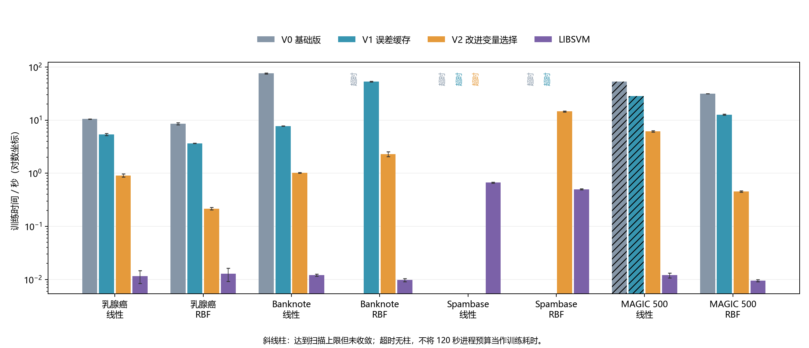
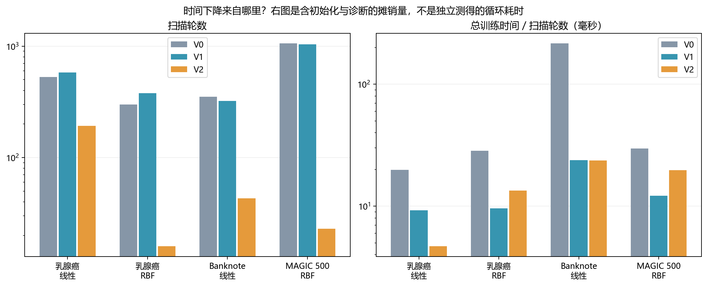
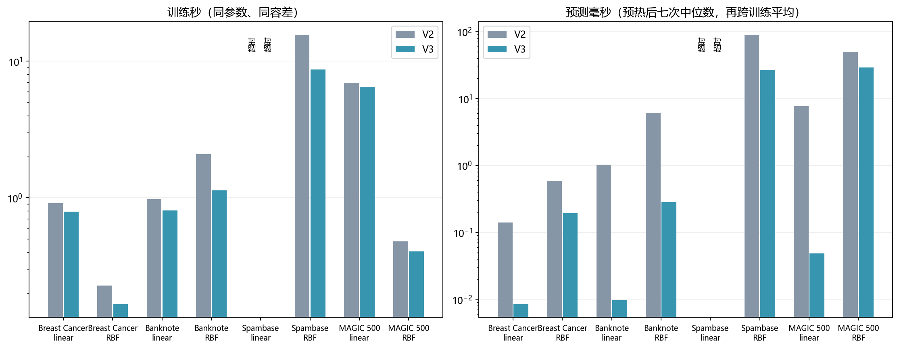
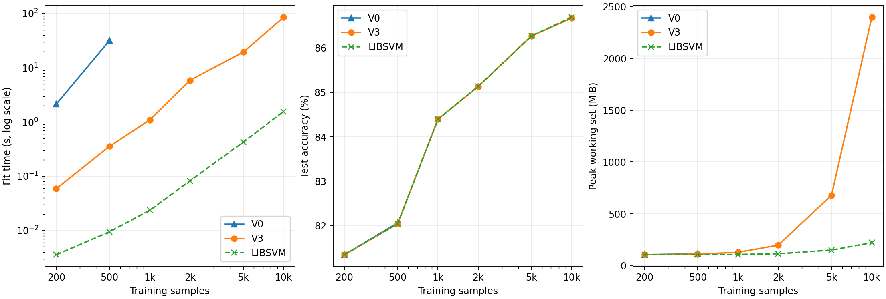
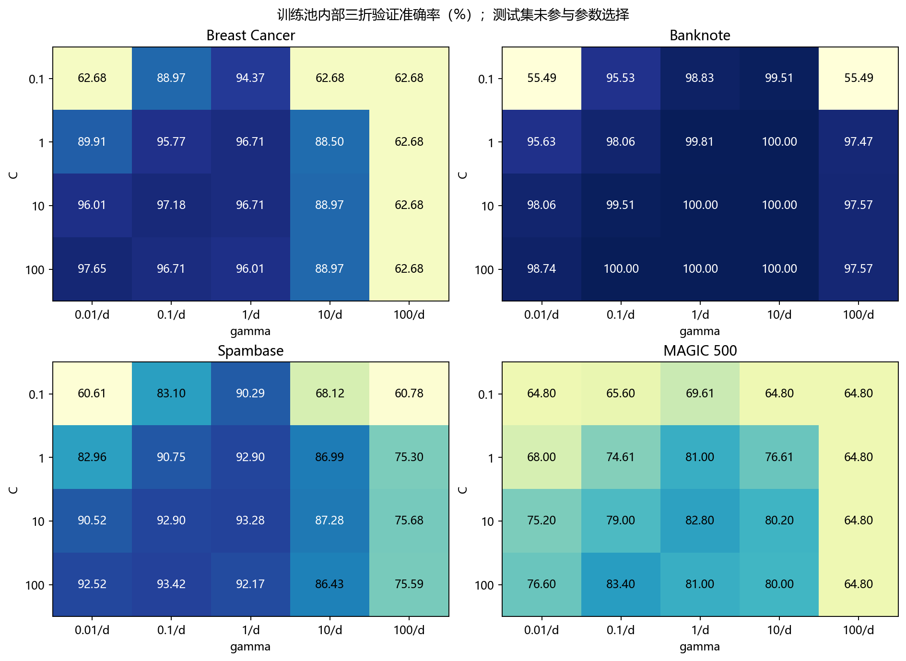

# 从 75 秒到 1 秒：自实现 SVM 的训练优化与 LIBSVM 对照

## 摘要

在 Banknote 的线性分类实验中，我写的基础求解器与 LIBSVM 得到了相同的测试预测，却用了 75.74 秒训练。这让我把代码检查分成两步：先看每轮有没有重复计算，再看完成训练需要多少轮。加入误差缓存后，训练缩短到 7.72 秒；改进变量选择后，又缩短到 1.02 秒。三个版本均收敛，测试准确率均为 97.67%。随后我用四个数据集区分了两个问题：同一模型能否算得更快，以及换一组特征与参数能否分得更准。前者可以用固定参数和残差检查验证，后者需要在训练集内选参数，并把最终测试留到选择完成后。固定 MAGIC 测试集扩大训练规模后，10,000 个训练样本上的 V3 与 LIBSVM 在测试正确总数上只差一个，但平均训练时间分别为 85.49 秒和 1.57 秒。

## 一、SVM 算法实现与优化过程

### 1.1 从分类目标到可以检查的基础实现

实验采用二分类软间隔 C-SVC，标签取 −1 和 +1，目标函数为

$$
\min_{w,b}\frac12\|w\|^2+C\sum_{i=1}^{n}\max(0,1-y_i f(x_i)).
$$

C 控制间隔与训练误差之间的权衡。预测函数为

$$
f(x)=\sum_{i=1}^{n}\alpha_i y_iK(x_i,x)+b.
$$

当 $f(x)\geq0$ 时，本实现预测 +1，否则预测 −1。线性核为内积，RBF 核为 $K(x,z)=\exp(-\gamma\|x-z\|^2)$。训练采用 SMO，每次只修改两个乘子，求解一个较小的子问题；基本思路参考 Platt 的工作[1]。

对偶变量需要满足 $0\leq\alpha_i\leq C$ 与 $\sum_i\alpha_i y_i=0$。若只改变一个乘子，一般会破坏等式约束。基础版的核心更新如下，摘录时省略了区间端点和偏置计算：

```python
s = y[i] * y[j]
eta = K[i, i] + K[j, j] - 2 * K[i, j]
slope = y[j] * (E[i] - E[j])
new_aj = np.clip(aj + slope / eta, L, H)  # eta > 1e-12 时
dj = new_aj - aj
di = -s * dj
a[i], a[j] = ai + di, new_aj
```

`L、H` 是保持两个乘子都在允许范围内的区间。`di = -s * dj` 让两项对等式约束的变化相互抵消；`clip` 则限制更新不要越界。重复样本可能使 `eta` 接近零，因此实际代码还有比较区间两端目标收益的分支，不能直接除以零。

这段代码也为第二项优化提供了线索：更新量包含 `E[i] - E[j]`。不过它还受 `eta` 与 `[L,H]` 影响，所以仅凭误差差值不能保证挑到最优变量。

在 `svm.py` 中，停止判断使用独立重算的残差：

```python
self.diagnostics_ = self.diagnostics()
if self.diagnostics_["kkt_max"] <= self.tol:
    self.stop_reason_ = "converged"
    break
if changed == 0:
    self.stop_reason_ = "stalled"
    break
```

达到扫描上限另记为 `max_iter`。如果只检查程序是否返回了预测，便会把“收敛”“停止更新”和“达到上限”混为一谈。后面 MAGIC 的结果说明，这个区分并不是形式上的要求。

基础实现由大模型辅助编写。我保留线性核与 RBF 核两条路径，把训练、预测和独立诊断分别作为可以调用的步骤。这样一来，某个样本预测错了，可以先检查模型是否解到了给定容差，再去看决策函数和标签约定。第 3.3 节记录了两个实际触发修改的测试。

### 1.2 修改前：在 V0 的训练循环里找到两个问题

Banknote 线性核上，V0 达到了收敛要求，测试准确率为 97.67%，但训练用了 75.74 秒。为了弄清这 75 秒花在哪里，我沿着一次扫描的执行顺序读了基础版代码。

**问题一：检查下一个样本时，为什么又算了一遍全部误差？** 下面摘出 V0 检查样本的两行代码：

```python
for i in range(n):
    E = K @ (a * y) + self.b_ - y
    r = y[i] * E[i]
    # 根据 r 决定是否需要为样本 i 寻找配对变量
```

第一行计算所有样本的误差，第二行先取其中一个值检查。如果当前样本无需更新，乘子和偏置都没有变化，到下一个样本时却会完整重算同一个向量。即使发生更新，也只改了两个乘子和偏置。对稠密核矩阵，这次矩阵向量乘法约需 O(n²) 工作，每轮执行 n 次。由此我推测，保存上一步的误差可以降低**每轮成本**。

**问题二：需要更新时，为什么总从同一个候选开始试？** V0 用 `for j in range(n)` 按编号尝试第二个乘子，找到第一个能产生有效更新的配对就结束尝试。编号决定了尝试顺序，而这次更新能走多远，还与两个样本的误差差值和可行区间有关。Banknote 上 V0 共扫描了 351 轮。我想检验，先试一个误差差值较大的候选，能否减少**达到收敛所需的轮数**。

### 1.3 针对两个问题，依次把 V0 改成 V1、V2

我把两处修改分开实施。先让 V1 沿用 V0 的候选顺序，观察仅改变误差计算会怎样；再从 V1 出发修改候选顺序。这样，第 1.4 节中 V0 与 V1 的对照检验第一个判断，V1 与 V2 的对照检验第二个判断。

#### 第一步（V0 → V1）：把误差重算改成增量更新

令 $E_k=f(x_k)-y_k$。更新前后的决策函数相减，未改变的乘子项全部抵消，得到

$$
E_k^{new}=E_k^{old}
+y_i\Delta\alpha_iK(x_k,x_i)
+y_j\Delta\alpha_jK(x_k,x_j)+\Delta b.
$$

于是 V1 在初始化时令 `E = -y.copy()`，因为初始乘子与偏置均为零；每次成功更新后执行：

```python
old_b = self.b_
# 计算 di、dj，并更新两个乘子与 self.b_
E += y[i] * di * K[:, i] + y[j] * dj * K[:, j] + self.b_ - old_b
```

这里取两列核值、做向量加法，每次约需 O(n) 工作。不能漏掉偏置变化：即使两个乘子的增量正确，所有样本的决策值还会一起受到 b 变化的影响。

为了检查缓存是否漂移，V1 在每轮结束、重新确定偏置后进行校准，核心代码为：

```python
exact_E = -target + self.b_  # target = y - K @ (a * y)
E += self.b_ - sweep_b      # 同步本轮末尾的偏置重估
self.cache_drift_ = max(
    self.cache_drift_, float(np.max(np.abs(E - exact_E))))
E = exact_E
```

本阶段记录到的最大校准前漂移约为 $2.14\times10^{-13}$，最终残差检查仍从模型重新计算。保留每轮校准会增加一些开销，但在课程实验中，我更愿意先获得一个容易检查的版本，而不是为了少做一次计算增加验证难度。

#### 第二步（V1 → V2）：把按编号尝试改成优先尝试误差差值大的候选

到 V1，程序检查样本时已经可以直接读取缓存的 E，但寻找第二个乘子仍从编号 0 开始。V2 直接利用这份缓存，比较候选的 `abs(E[i] - E[j])`，把差值最大的候选移到队首。对应代码如下：

```python
order = range(n)
if self.heuristic:
    candidates = np.flatnonzero((a > 1e-8) & (a < self.C - 1e-8))
    candidates = candidates[candidates != i]
    if not len(candidates):
        candidates = np.flatnonzero(np.arange(n) != i)
    first = int(candidates[np.argmax(np.abs(E[i] - E[candidates]))])
    order = [first] + [j for j in range(n) if j != first]
for j in order:
    # 使用与 V1 相同的可行区间、更新公式和偏置处理
    ...
```

这里先在自由变量中寻找候选，没有自由候选时再扩大范围。优先候选并非总能成功：它可能受到可行区间限制，也可能产生很小的更新，所以代码将其放在队首后保留其他变量的遍历。`...` 仅表示摘录省略，实际实现包含完整更新逻辑。

这项修改增加了候选搜索和列表构造成本，并不是“免费”的优化。因此我的预期不是每轮必然更快，而是额外选择成本有可能换来更少的扫描轮数。该策略也不等同于 LIBSVM 的二阶工作集选择方法[2]；我选择它，是因为它与现有误差缓存直接衔接，而且能解释清楚为何要试、失败时怎么办。

### 1.4 逐步叠加实验：快在每轮，还是快在轮数？

先看 V0 → V1 的“每轮摊销”列，再看 V1 → V2 的“扫描轮数”列，同时核对三行的分类指标。下表是 Banknote 线性核的三次训练均值。每轮摊销用总训练时间除以完整扫描轮数，包含初始化和诊断等开销。

|版本|训练时间|扫描轮数|每轮摊销|测试 Accuracy / F1|
|---|---:|---:|---:|---:|
|V0 基础版|75.74 秒|351|215.8 ms|97.67% / 0.9744|
|V1 误差缓存|7.72 秒|323|23.9 ms|97.67% / 0.9744|
|V2 改进变量选择|1.02 秒|43|23.7 ms|97.67% / 0.9744|

从 V0 到 V1，轮数只少了 28 轮，每轮成本却降到了原来的约九分之一。从 V1 到 V2，每轮成本很接近，扫描从 323 轮减到 43 轮。两次提速看起来相似，原因却可以用这两列数据区分。



**图 1　各配置的平均训练时间。** 纵轴采用对数尺度。超时配置没有精确的训练秒数。



**图 2　两种优化如何改变成本。** MAGIC RBF 的 V1 到 V2 从 1,041 轮降到 23 轮，单轮摊销反而从约 12.2 ms 升到 19.7 ms。多花时间选择候选仍有价值，因为总训练从 12.70 秒降到 0.45 秒。图中只能观察总量和摊销量，无法分离候选选择本身花了多少时间。

## 二、与 LIBSVM 的性能比较

### 2.1 实验环境、数据集与公平性设置

实验在 Windows、AMD Ryzen 9 7945HX、约 32 GB 内存的机器上运行。Python 为 3.11.3，NumPy 为 2.4.6，scikit-learn 为 1.9.1，官方 libsvm-official 为 3.37.0。scikit-learn 只负责数据划分、标准化和指标计算，自实现求解器只依赖 NumPy。环境版本保存在 requirements-lock.txt。

数据来自 UCI：Breast Cancer 为 569×30，Banknote 为 1,372×4，Spambase 为 4,601×57，MAGIC 为 19,020×10。MAGIC 来自模拟数据，不能将该实验解释为对真实观测部署效果的验证。前三个数据集采用分层 75%/25% 训练测试划分，训练数分别为 426、1,029、3,450；主实验的 MAGIC 从同样划分后的训练池抽取 500 个样本（规模扩展见 2.3 节），测试集为 4,755。随机种子均为 42，标准化只拟合实际训练子集。

上述主实验各版本固定 C=1，RBF 的 gamma=1/特征数，最大 KKT 残差目标为 0.001。LIBSVM 的停止容差参数同为 0.001，并额外用同一公式检查最终残差；相同参数名不代替实际核验。Accuracy 为测试准确率，F1 针对 +1 类：乳腺癌的恶性、Banknote 原标签 1、Spambase 的垃圾邮件和 MAGIC 的 gamma。

每个正常完成且收敛的配置运行三次，以均值和样本标准差报告耗时。每次新建进程，将数值库相关线程环境变量设为 1。超时或达到上限后不重复该配置。120 秒是包含加载、训练、预测、检查和保存的进程预算，不是精确的训练时间下界。最大扫描次数为 2,000。

训练计时包含核矩阵构建和自实现每轮诊断，LIBSVM 则包含 Python 接口数据转换；数据读取、标准化、训练后检查和模型保存不计入训练时间。LIBSVM 开启 Shrinking，缓存为 100 MB，而三个自实现版本都保存完整核矩阵。V0 与 LIBSVM 使用前一阶段同机、同设置的已保存结果，V1、V2 在本阶段交替顺序运行，因此耗时比是分阶段的工程对照，不是严格同步的硬件基准。

### 2.2 固定参数时，各实现的分类和耗时有多接近？

V2 完成了两步求解优化。进一步阅读它的停止检查时，我发现通用预测路径仍会重新构造训练核矩阵。于是我在 V3 中复用已有的 K 来计算本轮决策值，并在线性预测时预先合并权重、在 RBF 预测时跳过系数为零的样本。V3 与 LIBSVM 在补充批次中同期计时。下表将早期 V0 与这一批次并列，以便看清改进的起点和终点。各版本间的直接计时比较以对应批次明细为准。

|数据集 / 核|V0 训练秒|V3 训练秒|LIBSVM 训练秒|Accuracy（V3 / LIBSVM）|F1（V3 / LIBSVM）|
|---|---:|---:|---:|---:|---:|
|Breast Cancer / linear|10.4837|0.7924|0.0114|95.80% / 95.80%|0.9400 / 0.9400|
|Breast Cancer / rbf|8.5330|0.1669|0.0121|97.20% / 97.20%|0.9608 / 0.9608|
|Banknote / linear|75.7373|0.8090|0.0122|97.67% / 97.67%|0.9744 / 0.9744|
|Banknote / rbf|超时|1.1294|0.0096|100.00% / 100.00%|1.0000 / 1.0000|
|Spambase / linear|超时|超时|0.6564|— / 93.14%|— / 0.9113|
|Spambase / rbf|超时|8.6884|0.5191|92.88% / 92.88%|0.9072 / 0.9072|
|MAGIC 500 / linear|53.1174（达上限）|6.4868|0.0124|77.79% / 77.79%|0.8406 / 0.8406|
|MAGIC 500 / rbf|31.4340|0.4042|0.0106|82.04% / 82.04%|0.8753 / 0.8753|

七个 V3 收敛配置的测试 Accuracy、F1 都与同参数 LIBSVM 相同。Spambase 线性核中，V3 超过进程预算，而 LIBSVM 完成了训练。再看 MAGIC 线性核，基础版虽有 77.83% 的准确率，却已用尽 2,000 轮，优化后的 V2 收敛时准确率反而略低。这是我坚持把“是否收敛”放在分类指标旁边的理由。



**图 3　固定参数下的 V2 与 V3。** Banknote RBF 的平均训练从 2.08 秒缩短为 1.13 秒，预测从 6.11 ms 缩短为 0.28 ms，测试标签逐个相同。训练时复用核矩阵、预测时减少参与计算的样本，影响的是两个不同阶段。

### 2.3 固定 MAGIC 测试集，把训练样本从 200 个扩到 10,000 个

前面的大样本实验来自 Spambase，小样本实验主要来自其他数据集。直接比较两者的耗时，分不清差异有多少来自样本数。因此我回到 MAGIC，保留原来 4,755 个测试样本和原来的 500 个训练样本。从这 500 个样本中分层抽取 200 个，再从剩余训练池分层追加到 1,000、2,000、5,000 和 10,000 个。每一级都包含上一级的样本，每一级内各实现使用完全相同的训练顺序。固定 RBF 核、C=1、γ=0.1、容差 0.001；每一级重新用该级训练子集拟合标准化。

V3 与 LIBSVM 每一级各运行三次，交替先后顺序。V0 单独按相同阶梯和预算运行，首次超时后停止向上扩展。每次另起进程，拟合结束立即读取 Windows 进程从启动到此时的峰值工作集，包含解释器、数据和库的常驻内存；计时只包含模型拟合。训练后分块重算全体训练样本的 KKT 残差，并检查乘子的等式与盒约束。三次耗时反映同一子集的计时波动。

|训练样本|V0 训练秒|V3 训练秒|LIBSVM 训练秒|测试准确率（V3 / LIBSVM）|峰值 MiB（V3 / LIBSVM）|
|---:|---:|---:|---:|---:|---:|
|200|2.1522 ± 0.0194|0.0587 ± 0.0035|0.0036 ± 0.0010|81.35% / 81.35%|106 / 106|
|500|31.8563 ± 0.2213|0.3568 ± 0.0493|0.0095 ± 0.0008|82.04% / 82.04%|111 / 106|
|1,000|超时|1.0991 ± 0.0226|0.0236 ± 0.0004|84.40% / 84.40%|129 / 108|
|2,000|—|5.9069 ± 0.4384|0.0821 ± 0.0224|85.13% / 85.13%|198 / 115|
|5,000|—|19.4795 ± 0.6432|0.4270 ± 0.0119|86.27% / 86.27%|679 / 150|
|10,000|—|85.4854 ± 2.7371|1.5687 ± 0.0342|86.67% / 86.69%|2398 / 221|



**图 4　同一批 MAGIC 测试样本上的规模曲线。** 左图时间轴为对数刻度，中图使用固定测试集，右图为训练结束前的进程峰值工作集。两条准确率曲线在多个规模上重合。表中训练秒数为均值 ± 样本标准差，内存为三次峰值的均值。超时按每进程 120 秒预算记录，“—”表示未运行。

**基础版能运行到哪一级？** V0 在 500 个样本上平均用了 31.86 秒，V3 用了 0.36 秒。扩大到 1,000 个样本，V0 首次触及进程预算，V3 三次均收敛，平均用时 1.10 秒。这个超时点给出了本机、本预算下的实际边界。

**更多样本带来了多少收益？** 从 200 到 5,000 个训练样本，两种实现的测试正确数都从 3,868 增至 4,102。再将训练量加倍，V3 多判对 19 个，LIBSVM 多判对 20 个。到 10,000 个样本时，两者分别判对 4,121 和 4,122 个，独立残差检查均通过。这里的“差一个”指正确总数之差；要确定哪些样本的预测不同，还需要逐样本标签记录。这一条固定划分的曲线表明扩充数据仍有收益，但最后增加的 5,000 个样本带来的准确率增幅仅约 0.4 个百分点。

**为这 19 个额外正确预测，我付出了什么？** V3 从 5,000 扩到 10,000 个训练样本后，拟合从 19.48 秒增至 85.49 秒，进程峰值从 679 MiB 增至 2,398 MiB。此时单张 float64 核矩阵就需要约 763 MiB，构造 RBF 核还会产生临时数组。LIBSVM 配置了 100 MB 核缓存，在 10,000 个样本上拟合用时 1.57 秒，进程峰值约 221 MiB。我会保留 V3 作为展示 SMO 更新过程的教学实现；若要反复比较大训练集上的参数，当前测量支持用 LIBSVM。这里只能比较这两种具体实现，时间和内存的差额不能全部归到核缓存上。

复现实验可在项目根目录依次运行 `.\.venv\Scripts\python magic_scale.py`、`.\.venv\Scripts\python magic_scale.py --baseline` 和 `python summarize_magic_scale.py`。[逐次记录与分层索引](../results/scale_magic/) · [实验脚本](../magic_scale.py)

### 2.4 核、参数与特征尺度：提高准确率要付多少代价？

Banknote 在线性核上约有 97.67% 的测试准确率，换用默认 RBF 后已判对全部 343 个测试样本。此时继续增大模型复杂度很难从这次测试中看出收益。Spambase 的情况相反，改变 RBF 参数仍能多判对少量样本，但训练代价显著增加。

为避免看着测试分数挑参数，我在每个原训练池内做分层三折验证，每折只用本折训练样本拟合标准化。用官方 LIBSVM 搜索 4 个 C 与 5 个 γ，再把选中的参数交给两个求解器。四个数据集合计 240 次验证训练。热图的每个数都是验证准确率。



**图 5　RBF 参数组合的三折验证准确率。** 同一行或同一列分别固定一个参数，便于观察哪个区域对另一个参数较敏感。

在 Spambase 上，验证最高分配置把 V3 从 1,151 个测试样本中判对 1,069 个提高到 1,074 个，但平均训练从 8.69 秒升至 75.30 秒。同参数的 LIBSVM 同样判对 1,074 个，只用 0.45 秒。如果课堂上要重复训练和演示，我会保留默认 V3；若主要目标是多识别几个样本，这 5 个样本的收益和额外的 66.6 秒都应写在结果里。

前一轮在 MAGIC 上把准确率提高到 83.95%，但选出的 C=100 使训练变慢。RBF 核用样本间的距离来判断相似程度，我想知道，如果先压缩绝对值大的特征取值，再做标准化，能否用较小的 C 得到同样好的分类边界。具体变换是 `sign(x) × log(1 + |x|)`，负值保留符号，零仍为零。

我沿用原来的 500 个训练样本，在相同三折上比较两组原始特征参数与四组变换后的参数。先筛出折内平均训练时间低于上一轮高分配置的候选，再按验证准确率选择，最后重新训练并在原测试集上比较。两组各训练三次，交替运行，容差同为 0.001。

|特征及 RBF 参数|测试正确数|准确率|平均训练时间|
|---|---:|---:|---:|
|仅标准化，C=100，gamma=0.01|3992 / 4755|83.95%|3.52 秒|
|带符号对数后标准化，C=10，gamma=0.03|4063 / 4755|85.45%|1.19 秒|

在相同测试划分上，新配置多判对 71 个样本，拟合时间减少约 66%。两组均通过独立残差检查。这里同时改了特征变换和参数，测到的是组合收益。时间只计模型拟合，特征预处理和参数搜索未计入该表。复现运行 `.\.venv\Scripts\python magic_feature_trial.py`，逐折与逐次结果在 `results/tricks/magic_feature_trial.json`。

带符号对数组合尚缺同特征、同参数的 LIBSVM 实测。85.45% 可以用于与旧 V3 比较。整个开发过程已查看过原测试集，因此这次提升仍需要在新划分上复核。

## 三、总结分析

### 3.1 哪项修改最值得保留？

如果只看 Banknote，V1 与 V2 都应保留：第一项拿掉了每轮重复工作，第二项把大量扫描省了下来。如果看 MAGIC 线性核，选择工作变量还决定了能否在 2,000 轮内达到残差要求。反过来，单纯收紧容差也有代价。在 MAGIC 默认 RBF 的专项实验上，容差从 0.001 收紧到 0.0001，扫描由 23 轮增至 39 轮，训练从 0.379 秒增至 0.853 秒，两次准确率均为 82.04%。因此正式对照沿用 0.001，并额外检查残差。

### 3.2 自实现与 LIBSVM 还差在哪里？

同参数的对照说明，自实现能在多组数据上复现 LIBSVM 的分类指标，求解时间仍有明显差距。以 Spambase RBF 为例，从默认参数切换到验证最高分参数，两种实现的准确率同步上升，V3 的训练却由约 9 秒增加到 75 秒，LIBSVM 两次都在 0.52 秒内。Python 中逐对尝试变量、每轮全量诊断以及 LIBSVM 开启的 Shrinking 都可能影响差距。现有实验分别验证了误差缓存和变量选择在自实现中的作用，尚不能给这些跨实现差异逐项分配贡献。

规模实验也改变了我对优化目标的判断。在 1,000 个 MAGIC 样本上，V3 已把基础版触及进程预算的训练缩短到 1.10 秒；到 10,000 个样本时，同一个 V3 的训练耗时仍约为 LIBSVM 的 54 倍。若继续优化，我会先检查构造完整核矩阵时的临时数组，再测修改后的峰值工作集和拟合时间。这比继续调整已经达到目标的分类准确率更切合这组数据暴露的问题。

### 3.3 大模型辅助编程：两个真正改变测试方法的例子

初次基础实现的小 C 测试暴露了没有自由支持向量时的偏置问题。只采用最近一次变量对更新的偏置，不能保证全部样本满足停止要求。当前代码每轮重估偏置：

```python
target = y - K @ (a * y)
free = (a > edge) & (a < self.C - edge)
if free.any():
    self.b_ = float(target[free].mean())
else:
    lower = ((y == 1) & (a < self.C - edge)) | ((y == -1) & (a > edge))
    upper = ((y == -1) & (a < self.C - edge)) | ((y == 1) & (a > edge))
    self.b_ = float((target[lower].max() + target[upper].min()) / 2)
```

自由支持向量的间隔条件可用于估计 b；没有自由变量时，则从边界样本给出的上下界确定它。若迭代尚未收敛，上下界还可能不相容，取中点并不代表求解完成，随后仍需检查残差。修复这个问题后，我认识到验证不能只用“容易分对”的数据，还需要构造会触及不同代码分支的情况。

重复且标签冲突的合成样本还暴露了零决策值的标签约定问题。不同实现对 f(x)=0 的处理可能不同，仅比较标签会误报。因此这一退化测试改为比较标签方向对齐后的决策值，并继续检查约束；普通案例仍检查预测一致程度。

这个经验与前面真实数据的临界样本相呼应：面对一个差异，先弄清是目标问题不同、数值精度不同、标签约定不同，还是实现错误，再决定修改哪一部分。直接修改代码直到预测标签一样，可能掩盖真正原因。

这两次调试让我改变了验收生成代码的顺序。先用小数据触发想检查的分支，核对决策值、可行性和停止条件，再扩大数据量计时。这样即使结果只相差一个标签，也能说明检查过什么，为什么需要改代码或改测试。

## 资料与实验记录

1. John Platt. Sequential Minimal Optimization: A Fast Algorithm for Training Support Vector Machines. Microsoft Research, 1998. [原始资料](https://www.microsoft.com/en-us/research/publication/sequential-minimal-optimization-a-fast-algorithm-for-training-support-vector-machines/)。
2. Chih-Chung Chang, Chih-Jen Lin. LIBSVM: A Library for Support Vector Machines. 2011. [官方项目与文档](https://www.csie.ntu.edu.tw/~cjlin/libsvm/)。
3. UCI 数据来源：[Breast Cancer](https://archive.ics.uci.edu/dataset/17/breast+cancer+wisconsin+diagnostic)、[Banknote](https://archive.ics.uci.edu/dataset/267/banknote+authentication)、[Spambase](https://archive.ics.uci.edu/dataset/94/spambase)、[MAGIC](https://archive.ics.uci.edu/dataset/159/magic+gamma+telescope)。原始文件来源及 SHA256 见 data/manifest.json。

[各版本与 LIBSVM 的逐配置对照](自实现SVM与LIBSVM详细对照.md) · [精确率、召回率及原始性能汇总](performance.csv) · [V3 调参与容差实验](tricks/V3与调参补充实验.md) · [项目环境和运行方法](../README.md)
