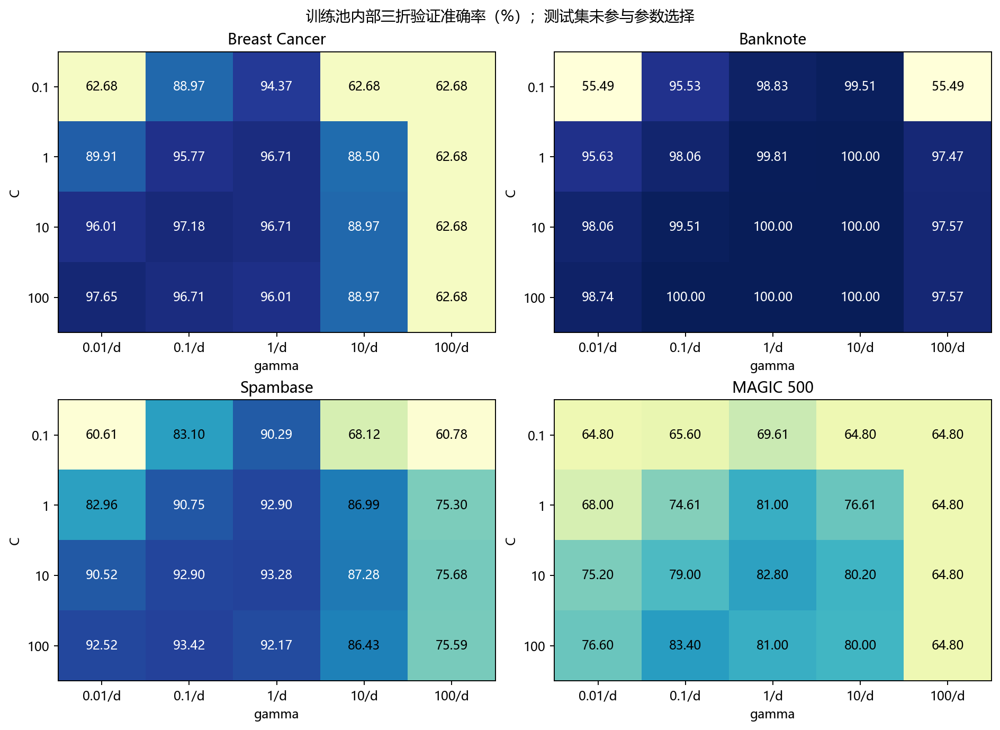
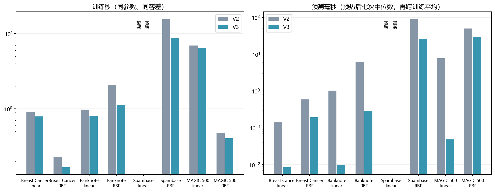
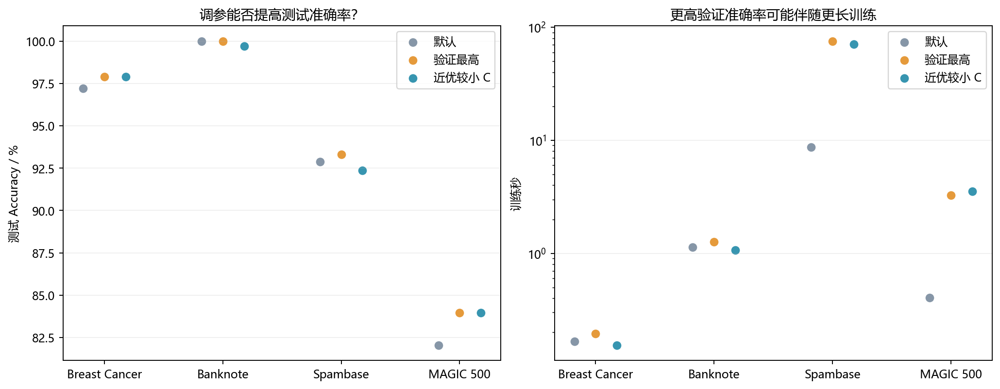

# V3 工程优化与参数搜索补充实验

本轮保留原 V0–V2，新增 V3。V3 每轮诊断复用已构建的核矩阵，仍每轮检查同一残差；训练结束独立重算核验。线性核预测预计算 w=Xᵀ(α⊙y)，RBF 仅保留严格非零系数（不以阈值剪裁），并检查与完整预测路径的差异。

## 协议与参数选择

固定参数实验同期运行 V2、V3、官方 LIBSVM，交替顺序，三次训练重复；线程设置为 1，C=1、gamma=1/d、tol=0.001，最大 2,000 轮、每进程 120 秒。计时包括训练内诊断和模型预测准备。预测计时预热一次、重复七次取中位数，再跨训练取平均，不能与旧报告单次预测耗时直接混比。

调参使用原训练池内部三折分层验证（seed=2026），每折单独拟合标准化，测试集及原训练样本范围不变。搜索 C={0.1,1,10,100}，gamma={0.01,0.1,1,10,100}/d，共每数据集 20 组、60 次 LIBSVM 验证训练；四个数据集合计 240 次。用 LIBSVM 选参数后，将相同参数用于 V3 与 LIBSVM，不能把调参提高的准确率归因于 V3 代码本身。

“best”最大化验证 Accuracy，完全并列时选较小 C，再较小 gamma。“economical”在验证最高准确率 0.5 个百分点内优先选较小 C，再较小 gamma；这只是预设的参数偏好，不保证训练更快。全部选择在测试评估前冻结，未根据测试分数回头修改搜索范围。MAGIC 只使用原先的 500 个训练样本。既有测试集已在早期开发查看，本次是探索性补充，不是新的盲测。



|数据|默认验证 Accuracy|最高验证 Accuracy|best C|best gamma|搜索总秒|
|---|---:|---:|---:|---:|---:|
|breast_cancer|96.71%|97.65%|100|0.000333333|0.82|
|banknote|99.81%|100.00%|1|2.5|0.90|
|spambase|92.90%|93.42%|100|0.00175439|37.43|
|magic|81.00%|83.40%|100|0.01|0.66|

## 代码里还有哪里在重复工作？

读 V2 的扫描循环时，我注意到误差虽然已经缓存，停止检查仍会调用训练集上的预测函数。预测函数按通用输入处理，又计算了一次训练集与自身的核矩阵。扫描开始前已经得到同一矩阵 K，停止条件只需要本轮的决策值。两版对应的代码是：

```python
# V2：诊断内部调用 decision_function(self.X_)
self.diagnostics_ = self.diagnostics()
# V3：使用本次训练已经构造的 K
self.diagnostics_ = self.diagnostics(K @ (a * y) + self.b_)
```

这一行仍按当前乘子做矩阵向量乘法，因此保留了原来的停止检查。预测另有一处可省：对线性核先保存 w，预测一批样本时只做 X @ w + b；对 RBF 核只计算乘子非零的训练样本与测试样本之间的核值。为了检查压缩有没有改变边界判断，每次训练后都额外计算完整决策值，逐个核对测试标签。独立核验在训练计时结束后执行。

## 同参数速度对照

仅对两端都收敛的结果计算加速比，超时没有可用耗时。三次训练均值用于下表。

|数据／核|V2训练秒|V3训练秒|训练加速比|V2预测ms|V3预测ms|预测加速比|测试预测一致率|
|---|---:|---:|---:|---:|---:|---:|---:|
|breast_cancer/linear|0.9138|0.7924|1.15×|0.1405|0.0085|16.46×|100.00%|
|breast_cancer/rbf|0.2272|0.1669|1.36×|0.5924|0.1931|3.07×|100.00%|
|banknote/linear|0.9765|0.8090|1.21×|1.0333|0.0097|106.53×|100.00%|
|banknote/rbf|2.0802|1.1294|1.84×|6.1135|0.2849|21.46×|100.00%|
|spambase/linear|timeout|timeout|—|—|—|—|—|
|spambase/rbf|15.5770|8.6884|1.79×|89.2700|26.5408|3.36×|100.00%|
|magic/linear|6.9742|6.4868|1.08×|7.7139|0.0484|159.38×|100.00%|
|magic/rbf|0.4784|0.4042|1.18×|50.0491|29.2352|1.71×|100.00%|



## 调参结果：展示所有选择，避免只挑测试集最优者

|数据|选择|实现|C|gamma|测试 Accuracy|F1|训练秒±SD|KKT残差|状态|
|---|---|---|---:|---:|---:|---:|---|---:|---|
|breast_cancer|default|v3|1|0.0333333|97.20%|0.9608|0.1669 ± 0.0107|0.000926|converged|
|breast_cancer|default|libsvm|1|0.0333333|97.20%|0.9608|0.0121 ± 0.0032|0.000544|returned|
|breast_cancer|best|v3|100|0.000333333|97.90%|0.9709|0.1954 ± 0.0798|0.000785|converged|
|breast_cancer|best|libsvm|100|0.000333333|97.90%|0.9709|0.0101 ± 0.0007|0.00044|returned|
|breast_cancer|economical|v3|10|0.00333333|97.90%|0.9709|0.1535 ± 0.0004|0.000909|converged|
|breast_cancer|economical|libsvm|10|0.00333333|97.90%|0.9709|0.0104 ± 0.0003|0.000607|returned|
|banknote|default|v3|1|0.25|100.00%|1.0000|1.1294 ± 0.0328|0.000971|converged|
|banknote|default|libsvm|1|0.25|100.00%|1.0000|0.0096 ± 0.0005|0.000481|returned|
|banknote|best|v3|1|2.5|100.00%|1.0000|1.2615 ± 0.0366|0.000972|converged|
|banknote|best|libsvm|1|2.5|100.00%|1.0000|0.0146 ± 0.0015|0.00053|returned|
|banknote|economical|v3|0.1|2.5|99.71%|0.9967|1.0668 ± 0.0895|0.000859|converged|
|banknote|economical|libsvm|0.1|2.5|99.71%|0.9967|0.0176 ± 0.0015|0.000494|returned|
|spambase|default|v3|1|0.0175439|92.88%|0.9072|8.6884 ± 1.0486|0.000999|converged|
|spambase|default|libsvm|1|0.0175439|92.88%|0.9072|0.5191 ± 0.0367|0.000509|returned|
|spambase|best|v3|100|0.00175439|93.31%|0.9132|75.3041 ± 1.4637|0.00098|converged|
|spambase|best|libsvm|100|0.00175439|93.31%|0.9132|0.4543 ± 0.0340|0.000557|returned|
|spambase|economical|v3|10|0.0175439|92.35%|0.9005|70.7528 ± 3.1278|0.000966|converged|
|spambase|economical|libsvm|10|0.0175439|92.35%|0.9005|0.4823 ± 0.0804|0.000544|returned|
|magic|default|v3|1|0.1|82.04%|0.8753|0.4042 ± 0.0654|0.000985|converged|
|magic|default|libsvm|1|0.1|82.04%|0.8753|0.0106 ± 0.0015|0.000512|returned|
|magic|best|v3|100|0.01|83.95%|0.8865|3.2613 ± 0.0449|0.000907|converged|
|magic|best|libsvm|100|0.01|83.95%|0.8865|0.0127 ± 0.0019|0.000484|returned|
|magic|economical|v3|100|0.01|83.95%|0.8865|3.5382 ± 0.1326|0.000907|converged|
|magic|economical|libsvm|100|0.01|83.95%|0.8865|0.0125 ± 0.0025|0.000484|returned|



## 结果解释

以上默认参数加速与调参收益应分开解释：前者保持优化问题不变，后者改变了模型的超参数。验证集更好不保证测试集更好；较小 C 也不保证更短训练。对超时或达到扫描上限的配置，不把预测指标作为充分收敛的性能结果，也不计算公平加速比。

LIBSVM 搜索耗时在参数表单列，不计入最终单模型训练时间；实际首次获得调参模型的成本还包含这部分搜索。所有原始选择、折索引、逐次记录与模型位于 results/tricks，源代码和协议哈希见 protocol.json。

复现：`.\.venv\Scripts\python check_fast.py`；`.\.venv\Scripts\python run_tricks.py`；`python summarize_tricks.py`。运行脚本自动复用已存在记录，若更改协议请使用新结果目录。

## 提前停止能省多少时间？

在 MAGIC 的 500 个训练样本上保持 RBF 参数不变，只改变允许的最大 KKT 残差。每种容差训练三次。

|容差|扫描次数|平均训练秒|测试 Accuracy|F1|实测最大 KKT 残差|
|---:|---:|---:|---:|---:|---:|
|0.01|16|0.1663|82.02%|0.8753|0.00927|
|0.001|23|0.3787|82.04%|0.8753|0.000985|
|0.0001|39|0.8531|82.04%|0.8753|8.83e-05|

这组时间只衡量不同停止要求的成本。前面的 V2 与 V3 加速比始终使用相同容差。复现本表请在汇总前运行 `.\.venv\Scripts\python tolerance_trick.py`。

## 回到最初的问题：能否同时更准、更快？

我先用同一组参数检查代码修改的作用，再看训练集选出的参数能否带来额外收益。下表将原 V2 默认 RBF 与验证准确率最高的 V3 比较。时间是参数确定后的一次训练均值，搜索成本见前表。

|数据|V2 默认 → V3 验证最高：测试正确数|训练秒|观察|
|---|---:|---:|---|
|breast_cancer|139 → 140（共 143）|0.227 → 0.195|多判对 1 个，训练缩短|
|banknote|343 → 343（共 343）|2.080 → 1.262|正确数持平，训练缩短|
|spambase|1069 → 1074（共 1151）|15.577 → 75.304|多判对 5 个，训练变长|
|magic|3901 → 3992（共 4755）|0.478 → 3.261|多判对 91 个，训练变长|

Banknote 的默认 RBF 在这次划分上已全对。我会保留默认参数，采用 V3 省下重复构造核矩阵的时间。Breast Cancer 的提升可以具体数成一个样本，因此我只把它作为这次划分上的改善。Spambase 的线性核在两个版本中都超过进程预算，说明省掉部分重复计算还不足以解决这组训练的耗时问题。
