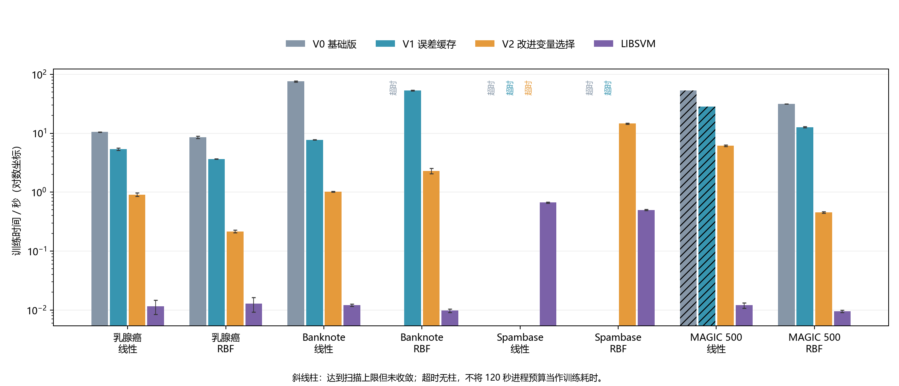
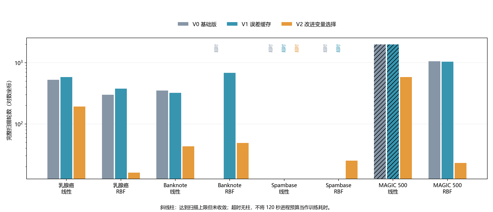

# 从“能分类”到“算得更快”：SVM 基础实现、两步优化与 LIBSVM 对照

> 学生课程实验报告初稿。实验日期：2026 年 11 月 5—6 日。代码、测试和初稿均在大模型辅助下完成；以下分析依据实际保存的运行记录。个人体会以本次开发中可核对的问题和选择为基础，提交前应结合自己的理解调整措辞。

## 一、实验目的与基本实现

本实验的目标是自己实现一个能够解释清楚的二分类 SVM，并通过修改代码观察性能变化。我没有把“超过 LIBSVM”作为必须达到的目标，而是希望回答三个问题：基础实现是否得到合理的分类结果？时间主要浪费在什么计算上？简单的改动能否在保持求解质量的同时减少训练时间？

实验采用软间隔 C-SVC，其目标为

\[
\min_{w,b}\frac12\|w\|^2+C\sum_{i=1}^{n}\max(0,1-y_i f(x_i)).
\]

其中标签为 −1 和 +1，C 控制间隔与分类错误之间的权衡。线性核直接计算内积；RBF 核为 \(K(x,z)=\exp(-\gamma\|x-z\|^2)\)。预测时计算

\[
f(x)=\sum_i\alpha_i y_i K(x_i,x)+b,
\]

再根据符号给出类别。训练采用 SMO：每次更新两个乘子，在保持等式约束的同时处理一个较小的优化问题。这一基本思路参考 Platt 的 SMO 工作[1]。

V0 的实现以清晰为先：预先计算完整核矩阵，依次检查样本是否违反 KKT 条件，然后按固定顺序尝试第二个变量；更新成功后再处理下一个样本。它没有误差缓存、Shrinking 或 JIT。这便于逐步理解算法，但也留下了明显的效率改进空间。核矩阵占用 O(n²) 内存，这里没有声称实现了原始 SMO 方法的全部工程特性。

正确性检查不只看准确率，还检查乘子的范围、等式约束及最大 KKT 残差，并记录是正常收敛、扫描达到上限还是运行超时。基础版和优化版分别经过线性数据、带噪非线性数据、重复且标签冲突的样本以及真实数据检查。

## 二、第一步：把已有结果转化为问题

初步实验中，Banknote 线性核的基础版与 LIBSVM 测试预测完全一致，但平均训练时间约为 75.74 秒，而 LIBSVM 约为 0.012 秒。另一方面，Banknote RBF 和 Spambase 两种核的基础版均触及 120 秒进程预算；MAGIC 500 个训练样本的线性核在扫描 2,000 轮后仍未收敛。

这些观察让我把“速度慢”拆成两个问题。第一，每一轮是否进行了过多计算？第二，是否因为选择的变量不够合适，需要过多轮才能停止？两者对应不同的修改：前者可以复用已有计算结果，后者需要改变迭代策略。只增加扫描上限可能让程序运行更久，却没有回答这两个问题，因此不作为第一项优化。

查看 V0 可以发现，下面这行代码位于逐样本循环内部：

```python
E = K @ (alpha * y) + b - y
```

它计算所有训练样本的误差，但紧接着只用其中的值来选择和更新一对变量。对于稠密核矩阵，一次乘法需要约 O(n²) 工作；扫描 n 个样本，仅重复重算这一部分就约为 O(n³)。这是代码结构的分析，并不是通过剖析精确测得的耗时占比。它已经提供了一个明确、容易验证的修改方向。

## 三、第二步：两项优化的判断、实现与验证

### 3.1 V1：保存误差，按变化量更新

**原问题与判断。** 一次 SMO 更新只改变 \(\alpha_i\)、\(\alpha_j\) 和偏置 b，其他乘子没有变化，因此每次重新计算全部求和会重复完成许多相同工作。我预期缓存能降低每轮成本，但它不直接改善变量选择，未必会减少扫描次数。

**具体修改。** 定义 \(E_k=f(x_k)-y_k\)，利用决策函数对乘子的线性关系，更新前后相减即可得到

\[
E_k^{new}=E_k^{old}+y_i\Delta\alpha_iK(x_k,x_i)
+y_j\Delta\alpha_jK(x_k,x_j)+\Delta b.
\]

对应代码只需从核矩阵取两列：

```python
E += y[i] * delta_i * K[:, i] + y[j] * delta_j * K[:, j] + delta_b
```

这次更新需要 O(n) 工作。V1 保持 V0 的样本扫描顺序、第二变量遍历顺序、参数和停止条件不变，只改变误差的计算方式。为避免累计数值误差，每轮结束重新计算并校准误差；偏置重新估计后也同步到缓存。最终 KKT 检查仍独立计算，不能让缓存自己证明自己正确。

**实验验证与解释。** Banknote 线性核从 75.74 秒降到 7.72 秒，约加快 9.8 倍，而扫描次数从 351 变为 323，变化远小于时间变化。这支持“主要减少每轮计算成本”的解释。更有意思的是，Breast Cancer RBF 的扫描次数从 299 增至 379，但耗时仍从 8.53 秒降至 3.65 秒。缓存并没有让每个案例的迭代次数都下降，也不需要依靠这一点才能发挥作用。

浮点运算次序不同会改变后续更新路径，所以 V1 的扫描次数并不严格等于 V0。这里保持的是算法选择规则，而不是逐位相同的运算轨迹。与其要求所有中间状态完全相同，更有意义的是检查最终约束、收敛残差和预测是否合理。

### 3.2 V2：优先尝试更合适的第二个变量

**原问题与判断。** V1 仍然按固定顺序寻找第二个变量。只要满足更新条件就接受，未考虑这次更新是否可能带来较大收益。例如 Banknote RBF 的 V1 虽然完成了训练，但仍扫描 682 轮、耗时约 53.15 秒。这表明降低单轮成本之后，迭代策略仍值得改进。

**具体修改。** V2 优先在自由变量（乘子处于 0 与 C 之间）中选择与当前样本误差差值最大的变量；如果没有这样的候选，就从其他样本中选择。优先候选不能有效更新时，再退回原来的遍历方式：

```text
检查样本 i 是否需要更新
优先尝试使 |E[i] - E[j]| 最大的候选 j
若该候选不能更新，则按原顺序尝试其他 j
成功后更新两个乘子、偏置和误差缓存
```

选择这个策略的理由是：SMO 更新量包含误差差值，优先考虑差值大的样本是一个直观启发式。但更新还受曲率和可行区间限制，因此最大误差差不保证最大目标改进，必须保留失败后的回退。这也不同于 LIBSVM 的二阶工作集选择方法[2]。

我没有直接复制 LIBSVM 的复杂求解器，因为那样很难区分自己理解了什么、哪项改动起了作用。此次只增加一个能解释的规则，并接受它不一定对所有数据都有用。

**实验验证与解释。** Banknote 线性核从 V1 的 323 轮降为 43 轮，训练时间从 7.72 秒降为 1.02 秒；RBF 从 682 轮降为 49 轮，时间从 53.15 秒降为 2.30 秒。Breast Cancer RBF 也从 379 轮降至 16 轮。这些结果支持第二项优化改善迭代效率的判断。这里只能说明 V2 在 V1 基础上的新增收益，不能把两项优化当作互不相关的独立贡献。

## 四、第三步：统一实验与版本对照

### 4.1 实验设置

实验在 Windows、AMD Ryzen 9 7945HX、约 32 GB 内存的机器上运行。Python 为 3.11.3，NumPy 为 2.4.6，scikit-learn 为 1.9.1，官方 libsvm-official 为 3.37.0。scikit-learn 只负责数据划分、标准化和指标计算，自实现求解器只依赖 NumPy。环境版本保存在 requirements-lock.txt。

数据来自 UCI：Breast Cancer 为 569×30，Banknote 为 1,372×4，Spambase 为 4,601×57，MAGIC 为 19,020×10。MAGIC 来自模拟数据，不能将该实验解释为对真实观测部署效果的验证。前三个数据集采用分层 75%/25% 训练测试划分，训练数分别为 426、1,029、3,450；MAGIC 从同样划分后的训练池抽取 500 个样本，测试集为 4,755。随机种子均为 42，标准化只拟合实际训练子集。

所有版本固定 C=1，RBF 的 gamma=1/特征数，最大 KKT 残差目标为 0.001。LIBSVM 的停止容差参数同为 0.001，并额外用同一公式检查最终残差；相同参数名不代替实际核验。Accuracy 为测试准确率，F1 针对 +1 类：乳腺癌的恶性、Banknote 原标签 1、Spambase 的垃圾邮件和 MAGIC 的 gamma。

每个正常完成且收敛的配置运行三次，以均值和样本标准差报告耗时。每次新建进程，将数值库相关线程环境变量设为 1。超时或达到上限后不重复该配置。120 秒是包含加载、训练、预测、检查和保存的进程预算，不是精确的训练时间下界。最大扫描次数为 2,000。

训练计时包含核矩阵构建和自实现每轮诊断，LIBSVM 则包含 Python 接口数据转换；数据读取、标准化、训练后检查和模型保存不计入训练时间。LIBSVM 开启 Shrinking，缓存为 100 MB，而三个自实现版本都保存完整核矩阵。V0 与 LIBSVM 使用前一阶段同机、同设置的已保存结果，V1、V2 在本阶段交替顺序运行，因此耗时比是分阶段的工程对照，不是严格同步的硬件基准。

### 4.2 性能对照

表 1 保留所有配置，包括失败和未收敛项。扫描轮数是完整遍历训练样本的次数，不应与 LIBSVM 内部迭代次数直接比较。三次重复的预测和扫描次数一致，因此指标与轮数列只展示一份；时间波动反映同一划分上的运行噪声，不表示泛化不确定性。

|数据／核|版本|训练秒（均值±标准差）|扫描轮数|Accuracy|F1|状态|
|---|---|---:|---:|---:|---:|---|
|乳腺癌／线性|V0 基础版|10.4837 ± 0.1001|529|95.80%|0.9400|收敛|
|乳腺癌／线性|V1 误差缓存|5.3768 ± 0.2347|582|95.80%|0.9400|收敛|
|乳腺癌／线性|V2 改进变量选择|0.9062 ± 0.0603|193|95.80%|0.9400|收敛|
|乳腺癌／线性|LIBSVM|0.0116 ± 0.0031|—|95.80%|0.9400|通过残差检查|
|乳腺癌／RBF|V0 基础版|8.5330 ± 0.3694|299|97.20%|0.9608|收敛|
|乳腺癌／RBF|V1 误差缓存|3.6465 ± 0.0244|379|97.90%|0.9709|收敛|
|乳腺癌／RBF|V2 改进变量选择|0.2156 ± 0.0108|16|97.20%|0.9608|收敛|
|乳腺癌／RBF|LIBSVM|0.0127 ± 0.0035|—|97.20%|0.9608|通过残差检查|
|Banknote／线性|V0 基础版|75.7373 ± 1.8428|351|97.67%|0.9744|收敛|
|Banknote／线性|V1 误差缓存|7.7234 ± 0.0769|323|97.67%|0.9744|收敛|
|Banknote／线性|V2 改进变量选择|1.0175 ± 0.0104|43|97.67%|0.9744|收敛|
|Banknote／线性|LIBSVM|0.0121 ± 0.0005|—|97.67%|0.9744|通过残差检查|
|Banknote／RBF|V0 基础版|—|—|—|—|timeout|
|Banknote／RBF|V1 误差缓存|53.1508 ± 0.7476|682|100.00%|1.0000|收敛|
|Banknote／RBF|V2 改进变量选择|2.3022 ± 0.2315|49|100.00%|1.0000|收敛|
|Banknote／RBF|LIBSVM|0.0097 ± 0.0007|—|100.00%|1.0000|通过残差检查|
|Spambase／线性|V0 基础版|—|—|—|—|timeout|
|Spambase／线性|V1 误差缓存|—|—|—|—|timeout|
|Spambase／线性|V2 改进变量选择|—|—|—|—|timeout|
|Spambase／线性|LIBSVM|0.6651 ± 0.0116|—|93.14%|0.9113|通过残差检查|
|Spambase／RBF|V0 基础版|—|—|—|—|timeout|
|Spambase／RBF|V1 误差缓存|—|—|—|—|timeout|
|Spambase／RBF|V2 改进变量选择|14.6446 ± 0.3288|25|92.88%|0.9072|收敛|
|Spambase／RBF|LIBSVM|0.4993 ± 0.0087|—|92.88%|0.9072|通过残差检查|
|MAGIC 500／线性|V0 基础版|53.1174（单次）|2000|77.83%|0.8409|达到上限，未收敛|
|MAGIC 500／线性|V1 误差缓存|28.2604（单次）|2000|77.81%|0.8405|达到上限，未收敛|
|MAGIC 500／线性|V2 改进变量选择|6.1445 ± 0.1819|582|77.79%|0.8406|收敛|
|MAGIC 500／线性|LIBSVM|0.0120 ± 0.0012|—|77.79%|0.8406|通过残差检查|
|MAGIC 500／RBF|V0 基础版|31.4340 ± 0.1004|1057|82.06%|0.8754|收敛|
|MAGIC 500／RBF|V1 误差缓存|12.7012 ± 0.2641|1041|82.04%|0.8753|收敛|
|MAGIC 500／RBF|V2 改进变量选择|0.4534 ± 0.0143|23|82.04%|0.8753|收敛|
|MAGIC 500／RBF|LIBSVM|0.0095 ± 0.0004|—|82.04%|0.8753|通过残差检查|




图 1：训练时间对比，纵轴为对数坐标，误差线为三次运行的样本标准差。超时没有绘制为 120 秒的柱子；斜线柱表示已返回模型但达到扫描上限，不能作为充分收敛的速度结果。



图 2：三个自实现版本的扫描次数。该图用于区分“每轮计算更便宜”和“需要更少的轮数”。LIBSVM 不在这张图中，因为其内部迭代计数与这里的完整扫描不是同一口径。

结果还揭示了两个不能被平均加速比掩盖的现象。Spambase 线性核中，V0、V1、V2 都触及进程预算，因此两项优化没有使这一配置在当前预算内完成。对 Spambase RBF，V0 和 V1 超时，V2 则在平均 14.64 秒、25 轮内收敛，Accuracy 为 92.88%，与 LIBSVM 相同。变量选择的作用因此与具体配置有关，不能说所有较大数据都已解决。

MAGIC 线性核中，V0 和 V1 都达到 2,000 轮上限，V1 虽然运行更快，却未解决停止精度问题；V2 在 582 轮、平均 6.14 秒内收敛，Accuracy 为 77.79%。MAGIC RBF 的 V1、V2 则分别为 12.70 秒/1041 轮与 0.45 秒/23 轮。这里，“减少每轮成本”和“减少迭代数量”的区别比单一耗时数字更清楚。

本阶段每轮校准前记录的最大误差缓存漂移约为 2.14×10⁻¹³，成功收敛的配置均通过最终独立残差检查。它支持缓存实现的数值一致性，但不要求各版本的迭代轨迹完全一致。


### 4.3 与 LIBSVM 的差距及本轮范围

在成功收敛的配置中，自实现和 LIBSVM 的分类指标总体接近，但不必要求每个测试点完全一致。核函数、超参数和训练数据相同，只意味着求解相同的优化问题；有限容差、更新顺序和临界样本仍会导致微小预测差异。此次优化的主要目标是节省训练时间，不能用个别测试点变正确来证明模型泛化能力提高。

两项优化显著缩小了基础版的时间开销，但没有消除与 LIBSVM 的差距。例如 Banknote 线性核的 V2 约需 1.02 秒，LIBSVM 约需 0.012 秒。官方实现具有不同的工作集选择和工程实现[2]；本实验没有拆分测量这些因素，因此不能把全部差距简单归因于“Python 比 C++ 慢”。

为集中展示两项优化，本轮没有做参数网格搜索、额外规模曲线、峰值内存和缓存容量实验。MAGIC 500 样本的结果不等于全量训练表现。Breast Cancer 划分沿用了开发测试，因此这些结果适合作为课程中的实现对照，不能包装成全新的独立泛化评估。

## 五、第四步：开发中的真实问题与取舍

### 5.1 准确率之外，还需要检查程序是否正确停止

基础实现开发时，小 C 的测试暴露了偏置处理问题：没有自由支持向量时，仅依赖某次变量对更新后的偏置，不能保证全部样本满足停止要求。修正方法是在每轮结束时，根据全部样本约束重新确定偏置；有自由支持向量时使用相应估计，没有时使用可行区间。这件事使我认识到，普通数据上准确率看似正常，并不足以说明边界情况处理正确。

MAGIC 线性核的基础版也提醒我区分“代码返回”和“优化完成”。它的准确率与 LIBSVM 接近，但 KKT 残差约为 0.0458，高于目标 0.001。所以报告保留其预测指标用于诊断，同时明确标记未收敛，不用它计算公平的加速比。

### 5.2 两个实现预测不一致，不一定就是算法写错

重复且标签冲突的合成样本可能落在 f(x)=0 的决策边界上。不同实现对零值的分类约定不同，仅比较预测标签会误报问题。因此对这个退化案例，测试改为比较标签方向对齐后的决策值，同时检查约束和优化残差。

优化过程中又遇到了一个真实数据案例：Breast Cancer RBF 的 V1 准确率为 97.90%，比 V0 的 97.20% 多对一个样本。检查发现该测试样本在原始数据中的零起始行号为 86，其决策值分别约为 V0 的 −0.000185、V1 的 +0.000294、V2 的 −0.000062，均很接近零。因此，这个变化与边界附近的数值差异相符，不能据此声称误差缓存提高了分类能力。相关记录保存为 boundary_case.json。

### 5.3 优化也需要检查验收标准，而不只是改代码直到测试变绿

最初的回归测试同时使用 KKT 容差和一个固定的相对原始—对偶间隙阈值。V1 在一个小合成数据、C=10 的配置上满足 KKT 要求，但没有通过额外的相对间隙阈值。缓存漂移约为 10⁻¹⁵，未显示明显的缓存错误；将容差直接收紧到 10⁻⁵，又使另一个配置在 2,000 轮内未完成。

这里没有继续扩大迭代上限或只删除失败断言，而是检查两个标准的关系。对可行的软间隔解，原始—对偶间隙可由每个样本的互补条件残差累加控制，因此测试采用与 C、训练样本数和 KKT 容差相匹配的界限，并继续报告实际间隙。V1、V2 最终各通过 24 组回归检查。这个过程说明，测试标准也需要有明确含义；修改标准的原因必须记录，不能把它当作隐藏失败的方法。

### 5.4 为什么保留简单实现和失败记录

本次只做误差缓存和一个变量选择启发式，没有叠加 Numba、Shrinking 或复杂缓存策略。这是为了让每项改动都能对应一个问题，并让前后对比容易解释。三个版本仍采用相同的完整核矩阵、偏置处理和最终检查，保留了较清楚的比较基础。

超时记录也属于实验结果。若删除失败配置，报告会只剩下容易运行的数据，掩盖基础版的适用范围。Windows 下还需要终止整个训练进程树，而不是只结束虚拟环境启动器，否则残留计算会干扰下一次计时。这个处理没有改变 SVM 算法，却是使实验结果可信的必要工程工作。

大模型参与了基础代码、优化代码、测试脚本和文字初稿的生成。对这次实验而言，重要的学习内容是能否解释更新公式、识别停止条件和数值边界、根据失败记录调整验证方式。代码由工具生成并不意味着已经正确；最终应以能复现的测试和自己能够说明的逻辑为依据。

## 六、总结

本实验从一个容易阅读但效率较低的 SVM 出发，将问题分成“每轮计算成本”和“迭代效率”两部分，再分别进行优化。误差缓存使已有计算结果得到复用，变量选择启发式则在多个案例中减少了扫描次数。Banknote 线性核从约 75.74 秒降至约 1.02 秒，分类指标保持一致；这比仅给出一个最终准确率，更能说明两项修改的意义。

我认为本次最重要的收获是：优化不只是让某次运行变快，而是先判断哪里可以改变，再检查变化是否符合预期。扫描次数增加但总时间下降、准确率略高却只是边界样本变化、运行结束但未收敛，都是需要解释的结果。保留这些现象，才能说明自己理解了程序和实验，而不只是得到了几张好看的图。

## 参考资料

1. John Platt. Sequential Minimal Optimization: A Fast Algorithm for Training Support Vector Machines. Microsoft Research, 1998. [原始资料](https://www.microsoft.com/en-us/research/publication/sequential-minimal-optimization-a-fast-algorithm-for-training-support-vector-machines/)。
2. Chih-Chung Chang, Chih-Jen Lin. LIBSVM: A Library for Support Vector Machines. 2011. [官方项目与文档](https://www.csie.ntu.edu.tw/~cjlin/libsvm/)。
3. UCI 数据来源：[Breast Cancer](https://archive.ics.uci.edu/dataset/17/breast+cancer+wisconsin+diagnostic)、[Banknote](https://archive.ics.uci.edu/dataset/267/banknote+authentication)、[Spambase](https://archive.ics.uci.edu/dataset/94/spambase)、[MAGIC](https://archive.ics.uci.edu/dataset/159/magic+gamma+telescope)。原始文件来源及 SHA256 见 data/manifest.json。

## 附录：交付文件与复现

- V0：`svm.py` 中的 `SVM`；V1、V2：`svm_optimized.py` 中的 `SVMV1`、`SVMV2`。V0 保持原样。
- `check_optimized.py`：优化版回归测试。`results/v1_checks.json`、`results/v2_checks.json`：各 24 项检查结果。
- `benchmark.py`：训练、测试与超时管理。`results/baseline`、`results/optimization`：逐次记录、模型、划分及参数。
- `report/performance.csv`：更完整的数值汇总。`build_course_artifacts.py`：由记录生成表格和两张 PNG/SVG 图。

```powershell
# 在 D:\SVM 目录下运行；resume 复用已有结果，包括失败记录
.\.venv\Scripts\python check_optimized.py
.\.venv\Scripts\python benchmark.py --optimize --resume --timeout 120
# 图表生成使用本机已有的 matplotlib 3.10.7
python build_course_artifacts.py
```

训练依赖由虚拟环境锁定；图表由本机全局 Python 的 matplotlib 3.10.7 生成，不参与训练计时。报告数据来自固定划分的已保存结果，重新训练时应同时核对版本与协议。正文没有把尚未执行的参数敏感性、规模扩展和内存实验写成已完成工作。
